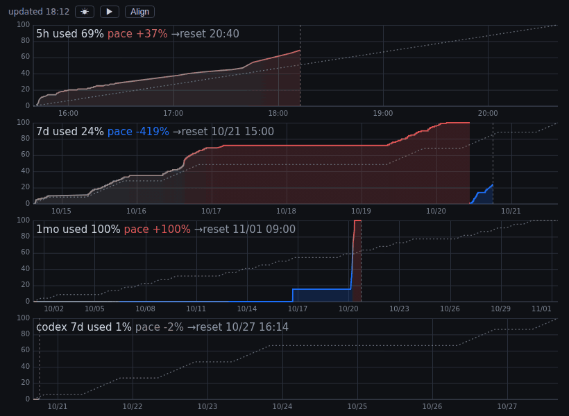

# claude-token-pace

Claude Code の**使用率**（5時間枠・7日枠などのレート制限）を、ブラウザのグラフで見るツールです。**標準ペースとの差**を色と数値で示すので、「このペースで枠を使い切ってしまわないか」が一目で分かります。**ローカルだけで動き、集めた使用量データは手元から出ません。**

*日本語 | [English](README.en.md)* ・ バージョン **0.4.1**（SemVer）

[](https://github.com/k-tashiro-arent/claude-token-pace/actions/workflows/ci.yml)
[](https://github.com/k-tashiro-arent/claude-token-pace/releases)
[](LICENSE)



## すぐ試す
```bash
curl -fsSL https://raw.githubusercontent.com/k-tashiro-arent/claude-token-pace/main/bootstrap.sh | bash
```
インストールしたら、Claude Code で `/tpw` と打つと既定のブラウザでビューアが開きます。対応環境と導入の詳細は[動作環境](#動作環境)・[インストール](#インストール)を参照してください。

この文書では次の 4 語を使い分けます。

- **枠** — 使用量の上限 1 本ぶん。「上限の量」と「どれだけの期間ぶんか」の組です。`5h`（5 時間ぶん）と `7d`（7 日ぶん）があり、環境によって月次クレジット枠 `1mo`（暦月ぶん・上限は金額）や Codex の枠が加わります。
- **期間** — 枠がリセットされてから次にリセットされるまでの区間。`5h` 枠なら 5 時間、`7d` 枠なら 7 日、`1mo` 枠なら 1 か月です。区切りごとに使用率が 0 に戻ります（Codex の枠だけは取り方が違います。→[Codex のレート枠](#codex-のレート枠任意)）。
- **標準ペース** — その枠を期間ちょうどで使い切るように配分したときの、**各時点の使用率**。いまの使用率がこれより高ければ先行（使いすぎ）、低ければ遅れ（余裕がある）と読みます。
  増え方は 2 通りです。期間が 1 日以内の枠は経過時間に比例して増え、それより長い枠は**就業時間**（既定は平日 9:00–18:00 JST。→[就業時間](#就業時間claudetoken-pacebiz-hoursjson)）の間だけ、その経過に比例して増えます。
- **パネル** — 枠 1 つぶんの表示。グラフと、その上のヘッダからなります。


## グラフの見方

- **used 線**: 枠の使用率（%）。標準ペースとの差に応じて 青（遅れ）〜灰（標準どおり）〜赤（先行）に着色します（Codex のパネルだけ遅れ側が緑）。
- **標準ペース（点線）**: 上で定義した標準ペース。
- **now 線**: 現在時刻（毎秒更新）。ホバーすると、その時点の使用率・標準ペース・`pace` の値が出ます。
- **予測の帯（任意）**: リセットまでに使用率がどこまで伸びそうかを、確率の帯として重ねて描きます。**別ツールが予測を書き出している環境でだけ**出ます（→[使用量の予測](#使用量の予測任意)）。
- **パネルのヘッダ**: `枠の名前 used NN% pace ±NN% →reset 時刻`。記録がまだ無い枠は「データ収集中…」と出ます。

### `pace` の値と色

`pace` は、使用率が標準ペースからどれだけ離れているかを、**標準ペースから 100% までの残り**に対する割合で表したものです。

```
pace = (使用率 − 標準ペース) ÷ (100 − 標準ペース) × 100
```

0% が標準どおり、プラスが先行（使いすぎ側）、マイナスが遅れです。たとえば標準ペースが 40% のときに使用率が 70% なら、残り 60 ポイント（40%→100%）のうち 30 ポイントを先に使っているので `pace +50%` になります。標準ペースが 100% に達して余地が無いときは `-` と表示します。

色は **0% が灰、+50% 以上で赤、−50% 以下で青**（Codex のパネルでは青の代わりに緑）に振り切れ、その間は連続して変わります（段階的なしきい値はありません）。

## パネルの構成

上から `5h`、`7d`。以降は環境に応じて増えます。

- **`1mo`** — 月次クレジット枠（extra usage）が使えるアカウントだけに出ます（→[月次クレジット枠](#月次クレジット枠extra-usage任意)）。
- **`codex 5h` / `codex 7d` など** — Codex の使用率を取れる環境だけに出ます（`codex` コマンドか会話ログのどちらかから数値を取れれば出ます）。枠の構成は Codex が返すものにそのまま追従します（→[Codex のレート枠](#codex-のレート枠任意)）。

上の 2 つと予測の帯はどれも任意です。使わない環境では何も出ないので、**月次クレジット枠・Codex のレート枠・使用量の予測の 3 節は読み飛ばして構いません。**

通常は各パネルが自分の期間（`5h` なら 5 時間、`7d` なら 7 日…）を横軸にします。**全パネルを共通の時間軸に揃えて**見比べることもできます（→[Align モード](#align-モード)）。

## なぜ便利か
- **既存の Claude サブスクだけで動く** — API キー不要・追加費用なし。Claude Code が既に持つレート制限データを読むだけ。
- **就業時間ベースの標準ペース** — 長い枠の標準ペースは、既定では夜間や週末に進まない。「今のペースは使いすぎか？」が実務的に分かる。
- **ローカル完結・非公開** — ビューアは `127.0.0.1` にだけバインドします。外へ出るのは**枠の値を取りに行く読み取りリクエストだけ**です。5h/7d 枠と月次クレジット枠は Anthropic の API へ直接、Codex の枠は `codex` 自身を通して取りに行きます。

## 動作環境
- **OS**: Linux / macOS / WSL2（**Windows ネイティブは対象外**）
- **前提**: Claude Code が使える状態になっていること
- **依存**: `python3`、`jq`、任意のブラウザ（入っていなければ各 OS のパッケージマネージャで入れてください）。下の**方法A**で入れるときは `curl` と `git` も使います
- レート制限（5h/7d 枠）のデータは、**5時間・7日の使用量上限がある Claude.ai のサブスクリプション契約（Pro / Max / Team など）**で、かつ **Claude Code にログイン済み**の環境で取得できます（認証情報は Linux / WSL では `~/.claude/.credentials.json`、macOS では Keychain にあります）。

## インストール
### 方法A: ワンライナー（curl→bash・推奨）
[すぐ試す](#すぐ試す)に挙げたコマンドです。内部でリポジトリを一時ディレクトリに clone し、install を実行します。

版を固定したいときは `| bash` を `| TOKEN_PACE_REF=v0.3.0 bash` に替えます（`curl` の側に付けても効きません）。

### 方法B: git clone（更新を `git pull` で行いたい場合）
```bash
git clone https://github.com/k-tashiro-arent/claude-token-pace.git
cd claude-token-pace
./install.sh
```

どちらの方法でも、インストーラは次を行います:
1. スクリプト/ビューアを `~/.claude/token-pace/` に配置
2. 既定の `config.json` / `biz-hours.json` を配置（既存があれば保持）
3. スラッシュコマンド `/tpw` を `~/.claude/commands/` に設置
4. **記録の定期実行を登録**（systemd の user timer。無ければ cron）。既定は **5 分おき**で、`TOKEN_PACE_INTERVAL=10min` のように**分で**変更、`TOKEN_PACE_NO_SCHEDULER=1` で省略できます。
5. **Claude Code の statusLine を「ラッパー」に差し替え**（元の設定は保存し、`settings.json` のバックアップも作ります）。**ステータス行の見た目は変わりません**。ステータス行の表示のときにも記録します（詳しくは[データの取得と蓄積](#データの取得と蓄積)）。

インストール後に特別な操作は要りません。記録が始まったかはビューアの画面で確かめます（→[トラブルシューティング](#トラブルシューティング)）。

> 設置先を変えたい場合: `TOKEN_PACE_DIR=/path/to/dir ./install.sh`
> このとき、以降に出てくる `~/.claude/token-pace/` はその場所に読み替えてください。**アンインストールも同じ変数を付けて**実行します（付け忘れると定期実行が消えません）。

## アップデート
- **curl 方式**: 同じワンライナーを再実行するだけ（毎回クローンし直して install）。
- **git clone 方式**: クローンを更新して再実行:
  ```bash
  cd claude-token-pace
  git pull
  ./install.sh
  ```

`install.sh` は何度実行しても同じ結果になります。プログラム（`bin/`・`index.html`）を上書きし、あなたの設定（`config.json`・`biz-hours.json`）は保持し、定期実行は登録し直すだけです。statusLine がすでにラッパーを指していれば変更しません（保存した元の設定も上書きしません）。更新時は `v旧 → v新` を表示します。

## 使い方
Claude Code で:
```
/tpw
```
ローカル HTTP サーバ（`127.0.0.1`）が起動し、既定ブラウザでビューアが開きます。`/tpw` は開いた URL とサーバの PID を Claude Code の画面に表示します。すでにサーバが動いていれば `/tpw` はそれを再利用するので、URL は変わりません。サーバはそのまま常駐します。停止するには表示された PID を `kill` するか、[アンインストール](#アンインストール)を実行してください。

## 画面の操作

画面の右上に 3 つのボタンがあります。テーマと `Align` の選択は記憶されます。

| ボタン | 動作 |
|---|---|
| `☀` / `☾` | 黒基調 / 白基調の切り替え（ボタンには切り替え後の基調の記号が出ます） |
| `▶` | 早送り再生。直近 7 日ぶんを 15 分刻みでなぞり、枠のリセットも再現します（約 6〜11 秒。**記録が 7 日ぶんに満たないうちは、そのぶん短くなります**） |
| `Align` | 全パネルを共通の時間軸に揃える（下記） |

### Align モード

`Align` を押すと **全パネルが同じ時間軸**（右端＝現在、幅は 30 日）に並び、枠をまたいだ消費の重なりを見比べられます。

- **いまの期間だけでなく過去の期間も並べます。** 枠がリセットされるたびに値が 0 付近へ戻るので鋸歯状になります（記録は数分おきなので、グラフ上はちょうど 0 ではなく 0 付近から再開します）。
- **使用量が下がる区間は線も塗りも描きません。** 下降が起きるのは枠のリセットのときだけで、連続した消費ではないためです（この扱いは通常モードでも同じです）。
- **標準ペースの点線は長い枠だけ**に引きます（`7d` / `1mo` / `codex 7d`）。`5h` 系は 30 日の中で本数が多すぎて読めないため出しません。
- **ヘッダは枠の名前だけ**になります（`used` / `pace` / `→reset` はいまの期間の話なので出しません）。
- このモードでの `▶` は、**30 日幅の表示範囲が 60 日前から現在まで滑る**再生になります。
- 記録が既定の長さに満たない環境では、軸が**全ログを通じた最古の記録**まで縮みます。軸は全パネル共通なので、記録の開始が遅いパネルは左側が空になります。

## データの取得と蓄積

- 使用率（5h/7d）は、**Claude Code 自身が使うのと同じエンドポイント** `GET https://api.anthropic.com/api/oauth/usage` から取得します。取得できないとき（トークンが無い・期限切れ・通信できない）は、その回は何も記録せず次の回に取り直します。
- **記録のきっかけは 2 つ**あります。定期実行と、Claude Code のステータス行の表示です（間隔は下の表）。どちらのきっかけでも同じ API から取得します（statusLine に渡される値は記録に使いません）。定期実行があるので **Claude Code が動いているかどうかに関係なく記録が続き**、使っていない間に枠が回復していく様子も残ります。常駐プロセスは置きません（`/tpw` で立つのは表示用の HTTP サーバだけ）。
- **ステータス行の表示のときは、定期実行が止まっていないかも点検し**、止まっていれば直します。結果は `tick.log` に残ります。
- **systemd も cron も無い環境では、Claude Code を使っている間だけ記録されます**（`~/.claude/token-pace/bin/tick.sh` を任意のスケジューラから数分おきに呼べば、使っていない間も記録できます）。
- **間隔の一覧**です。きっかけが来ても、下限より前なら各処理は飛ばします。

  | 対象 | 間隔 |
  |---|---|
  | 定期実行（きっかけ） | 既定 5 分おき（`TOKEN_PACE_INTERVAL` で分単位に変更） |
  | ステータス行の表示（きっかけ） | 1 分に 1 回まで |
  | 定期実行の点検・修理 | 10 分に 1 回まで（ステータス行の表示のとき） |
  | 使用率（5h/7d）の取得 | **最短 4 分に 1 回**（429 を受けたら 15 分休む） |
  | Codex の取得 | 最短 2 分に 1 回 |
  | グラフの作り直し | 最短 3 分に 1 回 |
  | 月次クレジット枠の取得 | 最短 5 分に 1 回 |

  使用率の取得に下限があるのは、短い間隔で叩くと API が `429` を返すためです（実測: 30 秒間隔で発生）。
- レート枠（5h/7d）は**アカウント（ユーザー）単位**で、返るのもアカウント全体の現在値です。**Claude Code を何セッション並行して動かしても、記録の内容も頻度も変わりません**（セッションごとに値が食い違うこともありません）。
- データは**インストールした環境ごとにローカルに蓄積**されます。複数マシンで使っても履歴は共有されず、各環境が独立に貯めます。インストール直後は履歴が無いため、特に 7d パネルは使い込むほど埋まっていきます。

## 月次クレジット枠（extra usage・任意）

プラン枠を超えた分の支出（usage credits）は、5h/7d と同じエンドポイントの別のフィールドから取得します（ステータス行の JSON には含まれません）。

- 取得: `GET https://api.anthropic.com/api/oauth/usage` を**約 5 分に 1 回**
- 認証: `~/.claude/.credentials.json`（`$CLAUDE_CONFIG_DIR` があればそちら）の OAuth アクセストークンを**読むだけ**。**macOS はこのファイルが無く Keychain に入るので、`security` コマンドでそちらを読みます**（Claude Code がファイルに出す方法は提供されていません。環境によっては Keychain のアクセス許可を求められ、許可しないと取得できません）。期限切れなら何もしません（トークンの更新は Claude Code 本体に任せます）。その間パネルは最後に取れた値のまま止まります（古い値だと分かる表示は画面に出ません）
- **リセットは UTC の月初**（日本時間では毎月 1 日 09:00）。API に月次枠のリセット時刻が無いため、この境界は実測に基づきます
- 取得できない環境（extra usage 非対応プラン、認証情報を読めない環境など）では**何も記録されず、パネルも表示されません**（5h/7d は同じ認証情報を使うので、読めない環境ではどちらも記録されません）

**注意**: このパネルの 100% は**支出上限**です。5h/7d の「使い切ってよい枠」とは意味が異なり、標準ペースちょうど（灰色）は「月末に上限を使い切る軌道」を意味します。

## Codex のレート枠（任意）

[Codex CLI](https://github.com/openai/codex) を使っている環境では、その使用率も同じ画面に並べて表示できます。

**この枠だけは「期間」の取り方が違います。** Codex が返すリセット時刻から、Codex が返す期間の長さぶん遡った区間を使います。使用率が 0% の間は Codex がリセット時刻を「今から 1 期間後」と返し続けるため区間も一緒にずれ、使用率が 0% を超えるとリセット時刻が固定されて区間も定まります。そのため前の区間と重なることがあります。Codex の使用率は上の API には載らないため、**2 つの経路**で集めます（どちらも同じ `codex.jsonl` に書きます）。

**1. `codex` コマンドに問い合わせる** — 使用率・期間の長さ・リセット時刻だけを取ります。**Codex で会話をしていない間でも現在値が取れます**（取りに行くのは記録のきっかけのときだけです）。会話は発生しないのでトークンを消費しません。`codex` が PATH に無い環境ではこの経路は動きません（`CODEX_BIN` でパスを指定できます）。

**2. Codex の会話ログを読む** — `$CODEX_HOME`（既定 `~/.codex`）に残る記録から、**使用率と時刻の数値だけ**を取り出します。**会話本文・ツール出力は解釈も保存もしません**（ファイルは追記された部分をまとめて読み、使用率と時刻の行以外は捨てます）。枠が載るのは会話が発生したときだけなので、これ単独では会話していない間の現在値が取れません。`codex` コマンドが無くてもこちらは動きます。

どちらの経路も記録のきっかけのたび（2 分以上の間隔）です。どちらからも何も取れない環境では記録されず、パネルも出ません。期間の長さは観測値から決めるので、枠の構成（5h+7d の 2 枠 / 7d の 1 枠）が変わっても追従します。標準ペースは他の枠と同じ規則で引きます。

**制限**:

- Codex 側のクレジット残高は取得できないので、月次パネルに相当するものは作れません。
- **使用率が 0% の間は、パネルに最新の 1 点しか出ません**（上記のとおり期間がずれるため）。使用が始まると区間が定まり、点が積み上がります。
- 枠を使い切ると枠の数値自体が返らなくなり、その間は記録されません。パネルは**最後に記録した値のまま残り**、その区間のリセット時刻を過ぎても新しい記録が無ければ**出なくなります**。
- 区間が引き直されて前の区間と重なるので、[Align モード](#align-モード)の標準ペースの点線は、その区間がいまの区間だった間にだけ描きます。
- どちらの経路も Codex CLI の内部仕様に依存するので、バージョンによって変わり得ます（読めなくなればパネルを出しません）。

## 使用量の予測（任意）

**別ツール [claude-codex-router](https://github.com/k-tashiro-arent/claude-codex-router) が同じ環境で動いていて、予測を書き出している場合にだけ表示されます。** 入っていなければ帯が出ないだけで、他の表示も動作も変わりません。

リセットまでに使用率がどこまで伸びそうかを、確率の帯として used 線に重ねて描きます。**濃いところほど起こりやすい範囲**で、中央の濃い帯が「ありそうな値」、外側の薄い帯が「まれにしか起きない値」です。

- **読み込み先**: `~/.claude/codex-router/data/forecast.json`。環境変数 `CLAUDE_CODEX_ROUTER_DIR` を設定していればそのディレクトリの `data/forecast.json`、`FORECAST_JSON` にファイルパスを直接指定すればそちらを優先します。
- **出る枠**: 予測側が持っている枠だけです。5h 枠・7d 枠・Codex の枠には出ますが、**月次クレジット枠には出ません**（予測側に月単位の枠が無いため）。
- **予測が今の状態と合っていないとき**は、帯を消さずに**黄色で薄く**描きます（通常表示のときだけ。再生中はカーソルの時刻そのものの予測を描くのでこの区別はしません）。予測が作られた時点の使用率と、いまの使用率が 5 パーセントポイントを超えて離れている場合です。
- **早送り再生でも出ます。** 15 分ごとの予測を 7 日ぶん手元に貯めており、再生中はその時刻の予測を描きます。**貯め始めてからのぶんしか無いので、使い始めは帯の出ない区間があり、最大 7 日かけて埋まります。** 帯が貯まるのは予測が書き出されている間だけなので、予測が無かった時間帯には帯が出ません。
- **Align モードでは描きません**。過去の並びを見るモードで、現在の予測が当てはまらないためです。

## 設定
### ポート（`~/.claude/token-pace/config.json`）
```json
{ "port": 8799 }
```
解決順: 環境変数 `TOKEN_PACE_PORT` > `config.json` の `port` > 既定 `8799`。指定ポートを優先し、埋まっていれば近傍を自動スキャンして起動します。

### 就業時間（`~/.claude/token-pace/biz-hours.json`）
長い枠（`7d` / `1mo` / Codex の 1 日超の枠）の標準ペースの基準です。
```json
{ "biz_days": [1, 2, 3, 4, 5], "biz_start_hour": 9, "biz_end_hour": 18 }
```
- `biz_days`: 就業曜日（1=月 … 7=日）
- `biz_start_hour` / `biz_end_hour`: 就業時刻（小数可）

標準ペースは描くたびに計算するので、**設定を変えると過去の区間の点線も新しい設定で引き直されます**（次にグラフが作り直されたときから）。

**時刻は JST（UTC+9）で解釈します。** マシンのタイムゾーンは見ていません。日本以外で使う場合は、自分の就業時刻を JST に換算して書いてください（例: UTC+1 の 9:00–18:00 なら `17` と `26`。24 を超える値も指定できます）。

JST 固定なのはこの判定だけです。**画面に出る時刻のうち、now 線と横軸はビューアを開いた端末のタイムゾーンで表示されます。`→reset` だけは記録を取った側（Claude Code が動いている環境）のタイムゾーンです。**

## データの場所
`~/.claude/token-pace/` に置かれます。

記録は `pace.jsonl`（5h/7d）・`credits.jsonl`（月次クレジット枠）・`codex.jsonl`（Codex）に貯まります。いずれも古い行を自動で捨てるので、際限なく増えることはありません。予測の記録 `forecast-hist.bin` は再生用で、7 日ぶんで約 3 MB（予測が無ければ作られません）。ビューアの入力 `pace.json` とビューア本体 `index.html`、各種設定・状態ファイルも同じディレクトリに置かれます。

## アンインストール
```bash
bash ~/.claude/token-pace/uninstall.sh
```
`/tpw` コマンドと定期実行（systemd の user timer / cron）を削除し、statusLine を元の設定に戻し、稼働中サーバを停止します（記録データは残します。完全削除は `rm -rf ~/.claude/token-pace`）。

## トラブルシューティング
- **ブラウザが開かない**: Linux は `xdg-open`、macOS は `open`、WSL は `powershell.exe` を使用。無い場合は表示された URL を手動で開いてください。
- **「データ収集中…」のまま**: まだ記録が始まっていません（→[動作環境](#動作環境)）。定期実行が動いているか確かめてください（`systemctl --user status claude-token-pace.timer`、cron なら `crontab -l`。どちらを使ったかは `.scheduler`）。**毎回の実行の結果は `~/.claude/token-pace/tick.log` に 1 行ずつ残ります**（取得できなかった理由も、ステータス行の表示時に定期実行を点検・修理した結果も、ここに出ます）。
- **ポートが埋まっている**: 自動で空きを探すので操作は要りません。固定したい場合は →[ポート](#ポートclaudetoken-paceconfigjson)。
- **予測の帯が出ない**: 条件と読み込み先は →[使用量の予測](#使用量の予測任意)。再生で過去の一部に帯が無いのは、その時刻の予測をまだ貯めていないためです。

## ライセンス
[MIT](LICENSE)
